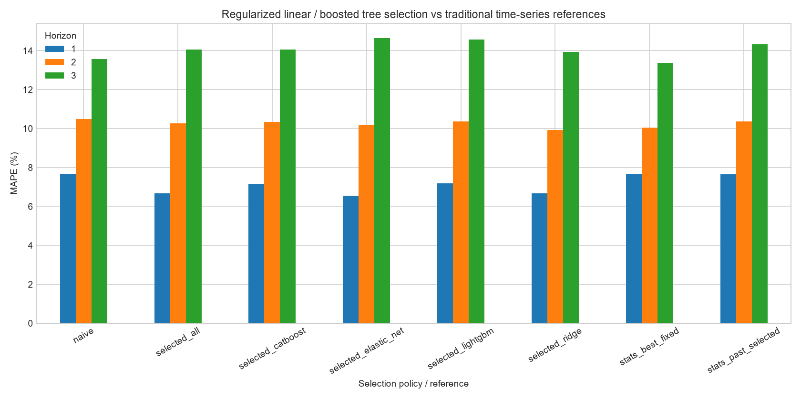

# 규제 선형회귀·트리 부스팅 비교 결과

Ridge·ElasticNet은 통계적 회귀이면서 지도학습 모델이다. LightGBM·CatBoost는 트리 기반 부스팅이다. 통계와 ML을 배타적으로 분류하지 않으며, 전통 시계열·규제 선형회귀·트리 부스팅·딥러닝의 구조별 그룹으로 설명한다.

4개 모델 × 8개 조합을 같은 원점에서 비교했다. H1/H2/H3 표본수는 83/82/81이다.
후보당 고정 설정 하나와 시드 42를 사용했으며, 하이퍼파라미터 최적화나 시드 안정성 검증은 아니다.

## 모델별 고정 조합 BEST (사후 선택)

| family | horizon | experiment | mape_pct | turning_f1_pct |
| --- | --- | --- | --- | --- |
| catboost | 1 | catboost__D_market | 7.1171 | 52.7778 |
| catboost | 2 | catboost__C_market | 10.2438 | 53.5211 |
| catboost | 3 | catboost__C | 13.4743 | 56.7901 |
| elastic_net | 1 | elastic_net__C_market | 6.3950 | 67.4419 |
| elastic_net | 2 | elastic_net__D_market | 9.4634 | 54.5455 |
| elastic_net | 3 | elastic_net__D_market | 12.4343 | 59.5238 |
| lightgbm | 1 | lightgbm__C_market | 7.0266 | 63.0137 |
| lightgbm | 2 | lightgbm__C_market | 10.2242 | 56.7568 |
| lightgbm | 3 | lightgbm__C | 14.0302 | 55.4217 |
| ridge | 1 | ridge__D_market | 6.3946 | 68.1319 |
| ridge | 2 | ridge__D_market | 9.3131 | 57.8947 |
| ridge | 3 | ridge__D_market | 12.0778 | 57.8313 |

전체 평가 구간을 본 후의 순위이며 당시 선택할 수 있었던 성능과 다르다.

## 과거 기반 선택 절차와 전통 시계열 기준선 MAPE

| experiment | 1 | 2 | 3 |
| --- | --- | --- | --- |
| naive | 7.6663 | 10.4804 | 13.5698 |
| selected_all | 6.6669 | 10.2726 | 14.0647 |
| selected_catboost | 7.1578 | 10.3353 | 14.0555 |
| selected_elastic_net | 6.5568 | 10.1715 | 14.6517 |
| selected_lightgbm | 7.1761 | 10.3619 | 14.5604 |
| selected_ridge | 6.6817 | 9.9202 | 13.9336 |
| stats_best_fixed | 7.6663 | 10.0566 | 13.3823 |
| stats_past_selected | 7.6580 | 10.3740 | 14.3226 |

selected_<family>는 해당 모델의 8개 조합 중 과거 성적으로 선택한 결과다. selected_all은 32개 후보와 Naive 중 선택했다.
stats_best_fixed는 사후 전통 시계열 BEST이며 stats_past_selected는 전통 시계열의 과거 기반 선택 절차다.

## 해석과 검증 범위

- BCOMNG 추가 효과는 market_effects.csv에서 모델·horizon·조합별로 확인한다. 음수이면 MAPE 개선이다.
- family별 BEST를 한 번 더 사후 선택하는 경우에도 독립 평가가 되지 않는다.
- 전통 시계열 후보는 가격만 사용하고 규제 선형회귀·트리 부스팅은 수급·시장 정보도 사용하므로 입력 정보와 모델이 함께 달라진 결과다.
- 미리 탐색한 데이터에서 조합을 정했으므로 완전히 미관측인 검증 구간이 아니다.
- 경고 기록 수: 0. 내용은 fit_diagnostics.csv에 저장했다. 실패한 원점을 제외하거나 Naive로 조용히 대체하지 않는다.
- 보고된 반전 F1은 기존 정확 부호 기준이며 작은 변화에도 민감할 수 있다.
- 제출 파일과 기존 최종 모델을 변경하지 않았다. DL 비교 및 모델별 설정 검증은 후속 단계다.

재현: `uv run python -m src.ml_experiment`, `uv run python -m src.ml_report`.
